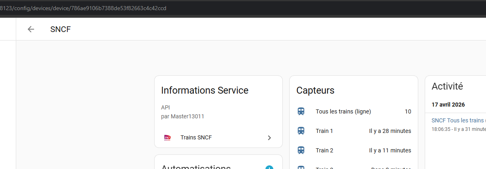

# 🚄 Intégration SNCF Trains pour Home Assistant


Suivez les horaires des trains SNCF entre deux gares dans Home Assistant, grâce à l’API officielle [SNCF](https://www.digital.sncf.com/startup/api).
Départ / arrivée, retards, durée, mode (TER…), tout est intégré dans une interface configurable et traduite.
Les numéros de voie sont récupérés, quand c'est possible, auprès de Gares & Connexions.

> ⚠️ **Limites connues**
> - Seuls les trajets **sans correspondance** sont conservés.
> - Les trains supprimés ne sont pas pris en compte.
> - Les numéros de voie reposent sur un point d'accès non officiel de Gares & Connexions : ils sont fournis « au mieux » et peuvent être absents (`N/A`).

---

## 📦 Installation

### 1. Via HACS (recommandé)

> Nécessite HACS installé dans Home Assistant

1. Aller dans **HACS**
2. Chercher **SNCF Trains**
3. Installer puis redémarrer Home Assistant

### 2. Manuel (sans HACS)

1. Télécharger le contenu du dépôt
2. Copier le dossier `sncf_trains` dans `config/custom_components/`
3. Redémarrer Home Assistant

---

## ⚙️ Configuration

1. Aller dans **Paramètres → Appareils & services → Ajouter une intégration**
2. Rechercher **SNCF Trains**
3. Suivre les étapes :
   - Clé API SNCF
4. Ajouter un trajet :
   - Ville et gare de départ
   - Ville et gare d'arrivée
   - Plage horaire à surveiller

Plusieurs trajets peuvent être configurés séparément.

---

## 🧩 Options dynamiques

### Intégration principale (Configurer)

- ⏱ Intervalle de mise à jour **pendant** la plage horaire
- 🕰 Intervalle **hors** plage horaire

### Par trajet (Reconfigurer un trajet)

- 🚆 Nombre de trains affichés
- 🕗 Heures de début et fin de surveillance

✅ Aucun redémarrage requis. Les modifications sont appliquées dynamiquement.

---

## 🔐 Clé API SNCF

Obtenez votre clé ici : https://numerique.sncf.com/startup/api/ -> Site HS

1. Créez un compte ou connectez-vous
2. Générez une clé API gratuite
3. Utilisez-la lors de la configuration (limite de 5 000 requêtes par jour)

> Pour changer de clé, cliquer sur **Reconfigurer** dans l'intégration.

---

## ⚙️ Variables de l'intégration

| Nom | Description |
|-----|-------------|
| `update_interval` | Intervalle de mise à jour **pendant** la plage horaire (défaut : 2 min) |
| `outside_interval` | Intervalle **hors** plage horaire (défaut : 60 min) |
| `train_count` | Nombre de trains à afficher |
| `time_start` / `time_end` | Plage horaire de surveillance (ex. : `06:00` → `09:00`) |

> 🕑 L'intervalle actif s'active automatiquement **1h avant** le début de plage.

---

## 📊 Capteurs créés

- `sensor.sncf_<gare_dep>_<gare_arr>` — capteur principal du trajet
- `sensor.sncf_train_X_<gare_dep>_<gare_arr>` — capteur par train
- `calendar.trains` — calendrier des prochains départs
- `sensor.sncf_tous_les_trains_ligne_X`

### Attributs du capteur principal

- Nombre de trajets
- Informations les inervalles

### Capteurs secondaires (enfants) pour chaque train

- Heure de départ (`device_class: timestamp`)
- Heure d’arrivée
- Retard estimé
- Durée totale (`duration_minutes`)
- Mode, direction, numéro
- Voie de départ (`platform`) et d'arrivée (`arrival_platform`) lorsqu'elles sont disponibles
- Nombre de rames (`train_units`), composition et type de matériel lorsqu'ils sont connus

---

## 🔔 Exemples d'automatisations Home Assistant

Les exemples suivants utilisent les **attributs d'un capteur individuel de train** (et non le capteur récapitulatif de la ligne). Remplacez `sensor.sncf_train_1_exemple` par l'identifiant réel visible dans **Outils de développement → États**, ainsi que `notify.mobile_app_mon_telephone` par votre service de notification.

> Les capteurs individuels correspondent à des positions dans la liste des prochains trains : un même capteur peut représenter une autre circulation après une mise à jour. Les exemples ci-dessous incluent donc le numéro du train dans le message. Ils notifient un **changement d'attribut**, pas systématiquement chaque actualisation. Si l'attribut est inconnu, aucune notification n'est envoyée.

### ⏱️ Notifier un retard annoncé ou modifié

Cette automatisation notifie lorsqu'un retard positif est renseigné ou change sur le capteur surveillé.

```yaml
alias: "SNCF - Notification de retard"
description: "Signale un retard nouveau ou modifié sur le train suivi."
triggers:
  - trigger: state
    entity_id: sensor.sncf_train_1_exemple
    attribute: delay_minutes
conditions:
  - condition: template
    value_template: >
      {{ trigger.to_state is not none
         and trigger.to_state.attributes.get('delay_minutes', 0) | int(0) > 0 }}
actions:
  - action: notify.mobile_app_mon_telephone
    data:
      title: "🚆 SNCF - Retard"
      message: >-
        Train {{ state_attr('sensor.sncf_train_1_exemple', 'train_num') or 'inconnu' }} :
        {{ state_attr('sensor.sncf_train_1_exemple', 'delay_minutes') | int(0) }}
        min de retard.
mode: single
```

### 🚃 Notifier la taille / composition du train

Cette automatisation notifie quand le **nombre de rames** devient disponible ou change. Elle ajoute le type de matériel et la composition lorsque ces données sont connues. Le nombre de voitures est facultatif et n'est pas assimilé au nombre de rames.

```yaml
alias: "SNCF - Notification de composition"
description: "Signale le nombre de rames lorsqu'il est disponible ou modifié."
triggers:
  - trigger: state
    entity_id: sensor.sncf_train_1_exemple
    attribute: train_units
conditions:
  - condition: template
    value_template: >
      {{ trigger.to_state is not none
         and trigger.to_state.attributes.get('train_units') | int(0) > 0 }}
actions:
  - action: notify.mobile_app_mon_telephone
    data:
      title: "🚃 SNCF - Composition"
      message: >-
        Train {{ state_attr('sensor.sncf_train_1_exemple', 'train_num') or 'inconnu' }} :
        
        {{ units }} {{ 'rame' if units == 1 else 'rames' }}.
        
        Matériel : {{ material }}.
        
        
          Composition : {{ composition | join(', ') if composition is sequence and composition is not string else composition }}.
        
mode: single
```

**À noter :** le déclenchement dépend de l'évolution de `delay_minutes` ou `train_units`. Un changement de train sans changement de la valeur surveillée ne provoquera pas de notification. Pour un suivi dédié à un numéro de train précis, ajoutez une condition sur l'attribut `train_num`.

---

## 🎨 Carte Lovelace — SNCF Train Card

La carte `sncf-train-card` est fournie dans le dossier `www` de l'intégration. Si elle n'apparaît pas dans le sélecteur de cartes, vérifier que la ressource Lovelace est déclarée en tant que **Module JavaScript** : `/sncf_trains/sncf-train-card.js`. Après une mise à jour, actualiser le cache du navigateur (au besoin en ajoutant un paramètre `?v=...` à l'URL de la ressource).

### Ajouter la carte

Dans un tableau de bord, cliquer sur **+ Ajouter une carte** → chercher **SNCF Train Card**.

La configuration peut ensuite se faire :

- via l'éditeur visuel Lovelace
- ou via YAML

Ou en YAML :

```yaml
type: custom:sncf-train-card
device_id: VOTRE_DEVICE_ID
```

#### ✨ Support Multi-Devices

Vous pouvez afficher les trajets de **plusieurs appareils sur une seule carte**, avec un tri chronologique par date d'arrivée :

```yaml
type: custom:sncf-train-card
device_id:
  - DEVICE_ID_1
  - DEVICE_ID_2
  - DEVICE_ID_3
title: 'Tous Mes Trajets'
train_lines: 10
```

### 🔍 Trouver le `device_id`

_S'obtient dynamiquement via la configuration visuelle._

Le `device_id` correspond à l'appareil créé lors de la configuration du trajet.

1. Aller dans **Paramètres → Appareils & services → SNCF Trains**
2. Cliquer sur le trajet souhaité
3. L'URL contient l'identifiant : `.../config/devices/device/XXXX`

> 

### ⚙️ Paramètres de la carte

| Paramètre | Type | Défaut | Description |
|-----------|------|--------|-------------|
| `device_id` | `string` ou `list` | requis | Appareil(s) SNCF à afficher
| `title` | `string` | `Trains SNCF` | Titre de la carte
| `visible_trains` | `number` | 	`3` | Trains affichés avant le bouton « Voir plus »
| `train_lines` | `number` | 	`10` | Nombre maximum de trains par sens
| `direction_titles` | `string` | (vide) | Titres des sens, séparés par `|` (sinon, la direction du premier train)
| `update_interval` | `number` | `30` | Rafraîchissement de l'affichage, en secondes (minimum 5). Les anciennes valeurs en millisecondes (≥ 5000) sont converties automatiquement
| `show_countdown` | `boolean` | `true` | Compte à rebours avant le départ
| `show_track` | `boolean` | `true` | Barre de progression du train
| `show_duration` | `boolean` | `true` | Durée du trajet
| `show_status` | `boolean` | `true` | Statut (à l'heure, retard, en circulation, arrivé)
| `train_emoji` | `string` | `mdi:train` | Icône `mdi:` ou emoji affiché sur la barre

### Prérequis et limites de la carte

- Elle lit le registre des entités : elle ne fonctionne que pour les utilisateurs administrateurs.
- Elle ne retient que les capteurs de l'appareil dont l'`entity_id` contient `train` : ne renommez pas les capteurs « Train N » en supprimant ce mot.
- Les trains arrivés depuis plus de 30 minutes sont masqués.
- Le libellé « TER » est affiché pour tous les trains.

### Exemple d'affichage


---

## 📸 Aperçus

**Carte capteur :**


**Détails du prochain train :**


**Dashboard Lovelace :**


---

## 🛠 Développement

Compatible avec Home Assistant `2025.8+`.

Structure :

custom_components/sncf_trains/
-  __init__.py        # Mise en place, migration, enregistrement de la carte
-  api.py             # Client API SNCF (journeys, stations)
-  calendar.py        # Entité calendrier
-  config_flow.py     # Configuration, options, sous-entrées (trajets)
-  const.py           # Constantes
-  coordinator.py     # Récupération des données, intervalle adaptatif
-  diagnostics.py     # Diagnostics
-  helpers.py         # Dates, numéro de train, durée
-  sensor.py          # Capteurs
-  strings.json / translations/fr.json
-  www/sncf-train-card.js   # Carte Lovelace
-  tests/             # Tests pytest

---

## 👨‍💻 Auteur

Développé par [Master13011](https://github.com/Master13011)
Contributions bienvenues via **Pull Request** ou **Issues**

---

## 📄 Licence
Distribué sous licence GNU AGPL v3 
